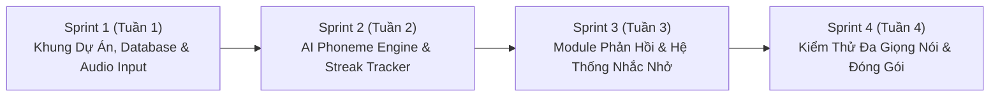

# 📋 KẾ HOẠCH PHÂN CHIA CÔNG VIỆC CHI TIẾT - BÀI TẬP THỰC HÀNH 3 (TH3)
## DỰ ÁN: ỨNG DỤNG HỌC TIẾNG ANH AI & THEO DÕI KỶ LUẬT HỌC TẬP (SPEAKUP AI)

---

> **Môn học:** Phát triển Ứng dụng Di động (Mobile Application Development - CSE441)  
> **Nhóm thực hiện:** Nhóm 16 — Lớp 65KTPM — Khoa Công nghệ Thông tin — ĐH Thủy Lợi  
> **Đề bài:** Xây dựng ứng dụng học tiếng Anh hoàn chỉnh với hai tính năng chính:  
> 1. Tính kỷ luật: Nhắc nhở luyện tập hàng ngày, theo dõi chuỗi ngày luyện tập (streak), thống kê tiến độ học tập.  
> 2. Phân tích & Chấm điểm phát âm tiếng Anh bằng AI: So sánh phát âm của người dùng với phiên âm chuẩn IPA và đưa ra gợi ý cải thiện.  

---

## 👥 1. BẢNG PHÂN CÔNG NHIỆM VỤ CHI TIẾT CHO 4 THÀNH VIÊN

| STT | Mã Sinh Viên | Họ và Tên | Vai Trò | Nhiệm Vụ Phụ Trách Cụ Thể | Sản Phẩm Bàn Giao (Deliverables) | Nhánh Git Phụ Trách | Trạng Thái |
|:---:|:---:|:---|:---:|:---|:---|:---:|:---:|
| **1** | **2351170599** | **Nguyễn Văn Huỳnh** | **Nhóm trưởng** (Architecture, Database & DevOps) | • **Checklist 1:** Thiết kế CSDL quan hệ lưu trữ hồ sơ người dùng (`users`), danh mục bài học (`lessons`), danh sách từ vựng/mẫu câu (`practice_words`), lịch sử học tập (`practice_sessions`), chi tiết chấm điểm (`pronunciation_logs`, `phoneme_results`). • Khởi tạo kiến trúc dự án Clean Architecture (Domain, Data, Presentation), cấu hình Theme Material 3 và Navigation. • Xây dựng tầng truy xuất dữ liệu `DatabaseHelper` (hỗ trợ SQLite Offline-First kết hợp Cloud Supabase). • **Checklist 7 (Chủ trì):** Thiết lập môi trường CI/CD, viết kịch bản kiểm thử tích hợp (Integration Tests), điều phối Git Flow, review code PR và đóng gói APK release. | • `th3_database_schema.sql` • `lib/data/database_helper.dart` • `lib/models/user_model.dart` • Sơ đồ kiến trúc Mermaid • Tài liệu kỹ thuật tổng thể TH3 • Bản build APK phát hành | `huynh-th3-architecture-database-testing` | 🚀 Đang thực hiện |
| **2** | **2151060296** | **Lê Anh Tuấn** | **Thành viên** (Habit, Streak & Notification Specialist) | • **Checklist 2:** Xây dựng logic đếm chuỗi ngày học liên tục (Streak Counter): tính toán ngày học hợp lệ, bảo vệ chuỗi ngày bằng tính năng Freeze Streak, tính toán và lưu trữ tổng thời gian học (phút/giờ) theo ngày, tuần, tháng. • Quản lý mục tiêu học tập (Daily Goals): Cho phép người dùng đặt mục tiêu (5p, 15p, 30p hoặc số bài phát âm) và theo dõi tỷ lệ hoàn thành (%). • **Checklist 6:** Xây dựng hệ thống thông báo nhắc nhở luyện tập hàng ngày (Local Push Notification qua `flutter_local_notifications` theo giờ người dùng cài đặt, gửi thông báo cảnh báo sắp mất chuỗi Streak vào 20:00 hằng ngày). • Xây dựng giao diện hiển thị tiến độ học tập: Streak Badge, Heatmap điểm danh học tập, biểu đồ tiến độ. | • `lib/services/streak_service.dart` • `lib/services/daily_notification_service.dart` • `lib/models/user_progress_model.dart` • `lib/views/progress_dashboard_view.dart` • `lib/widgets/streak_badge_widget.dart` • Test cases cho Streak Service | `letuan-th3-streak-progress-notification` | 🚀 Đang thực hiện |
| **3** | **2251172394** | **NGUYỄN TRUNG KIÊN** | **Thành viên** (Speech Recognition & Audio UI Engineer) | • **Checklist 3:** Tích hợp API nhận dạng giọng nói (Speech Recognition API: Google Speech-to-Text / Whisper AI / Native SpeechRecognizer) để thu âm giọng nói người dùng và chuyển đổi thành văn bản kèm mốc thời gian âm vị. • Xây dựng `AudioRecordingManager`: Quản lý luồng thu âm từ micro, xử lý định dạng tệp âm thanh chuẩn (WAV/AAC 16kHz, mono), tiền xử lý lọc nhiễu môi trường. • Tích hợp tính năng Text-to-Speech (TTS) hoặc phát âm thanh mẫu chuẩn người bản xứ (Native Speaker Audio) để người dùng nghe đối chiếu. • Xây dựng giao diện tương tác thu âm: Nút bấm Micro tương tác với hiệu ứng sóng âm thời gian thực (`WaveformVisualizerWidget`), bộ điều khiển phát lại giọng đọc của học viên. | • `lib/services/speech_recognition_service.dart` • `lib/services/audio_recording_manager.dart` • `lib/widgets/waveform_visualizer.dart` • `lib/views/pronunciation_practice_view.dart` • Mock audio test suite | `kien-th3-speech-recognition-audioui` | 🚀 Đang thực hiện |
| **4** | **2351170629** | **Trần Anh Tuấn** | **Thành viên** (AI Phoneme Scoring & Feedback Engine) | • **Checklist 4:** Nghiên cứu và hiện thực hóa thuật toán so sánh âm vị (Phoneme Comparison): Bộ chuyển đổi ký tự sang ngữ âm quốc tế (Grapheme-to-Phoneme - G2P), thuật toán căn gióng chuỗi âm vị (Phonetic Levenshtein Distance / Needleman-Wunsch Alignment). • Xây dựng công thức chấm điểm phát âm toàn diện: Chấm điểm Độ chính xác (Accuracy), Độ trôi chảy (Fluency), Độ đầy đủ (Completeness) theo thang điểm 0 - 100. • **Checklist 5:** Xây dựng module phản hồi: Hiển thị thẻ điểm số trực quan, tô màu chi tiết từng âm vị của từ (xanh lục: phát âm chuẩn; đỏ: phát âm sai; cam: nuốt âm/thiếu âm), giải thích khẩu hình miệng cải thiện. • Xây dựng thuật toán gợi ý bài tập cải thiện (Targeted Lesson Recommender) dựa trên tập hợp các âm vị người dùng thường xuyên đọc sai. | • `lib/services/phoneme_comparison_engine.dart` • `lib/services/pronunciation_scoring_service.dart` • `lib/models/pronunciation_result_model.dart` • `lib/widgets/phoneme_feedback_widget.dart` • `lib/widgets/score_card_widget.dart` • `lib/services/targeted_lesson_recommender.dart` • Test cases thuật toán chấm điểm âm vị | `trantuan-th3-ai-phoneme-scoring-feedback` | 🚀 Đang thực hiện |

---

## 📅 2. LỘ TRÌNH TRIỂN KHAI THEO CÁC SPRINT (SPRINT ROADMAP)

### 🔹 Sprint 1: Thiết lập Khung Ứng Dụng, Cơ Sở Dữ Liệu & Bộ Thu Âm (Tuần 1)
* **Mục tiêu:** Cài đặt xong kiến trúc ứng dụng, tạo bảng CSDL, thu âm được từ micro và nhận diện speech thô.
* **Công việc thành viên:**
  * **Nguyễn Văn Huỳnh:** Khởi tạo project Flutter, thiết kế file SQL Schema, cài đặt `sqflite` / Supabase client, dựng khung Model & Navigation.
  * **Lê Anh Tuấn:** Thiết kế cấu trúc lưu trữ lịch sử luyện tập cục bộ, định nghĩa mô hình `UserProgressModel` và bảng theo dõi chuỗi `daily_streaks`.
  * **Nguyễn Trung Kiên:** Cấu hình quyền Microphone trên `AndroidManifest.xml` & `Info.plist`, xây dựng `AudioRecordingManager`, kiểm tra khả năng ghi âm file WAV 16kHz.
  * **Trần Anh Tuấn:** Thu thập bảng phiên âm quốc tế IPA tiếng Anh chuẩn (44 âm vị: 20 nguyên âm, 24 phụ âm), chuẩn bị từ điển ngữ âm chuẩn (CMU Pronouncing Dictionary subset).

### 🔹 Sprint 2: Phát Triển Thuật Toán AI So Sánh Âm Vị & Đếm Chuỗi Streak (Tuần 2)
* **Mục tiêu:** Chấm điểm được chuỗi âm thanh phát âm và tính toán chuỗi ngày học liên tục.
* **Công việc thành viên:**
  * **Nguyễn Văn Huỳnh:** Hoàn thiện `DatabaseHelper`, viết các hàm CRUD lưu kết quả phiên học và chi tiết âm vị vào CSDL.
  * **Lê Anh Tuấn:** Xây dựng `StreakService` với logic kiểm tra ngày hiện tại và ngày học gần nhất:
    * Nếu khoảng cách = 0 ngày: Tiếp tục giữ nguyên streak, cộng dồn số phút.
    * Nếu khoảng cách = 1 ngày: Tăng `streak = streak + 1`.
    * Nếu khoảng cách > 1 ngày: Kiểm tra Freeze Streak, nếu không có thì reset `streak = 1`.
  * **Nguyễn Trung Kiên:** Tích hợp Speech Recognition Service, nhận diện chuỗi Text và tách timestamp các từ.
  * **Trần Anh Tuấn:** Hiện thực hóa thuật toán `PhonemeComparisonEngine`: Chuyển chuỗi Text thành dãy âm vị IPA, so sánh căn gióng với âm vị chuẩn qua thuật toán khoảng cách Levenshtein âm vị, tính điểm Accuracy.

### 🔹 Sprint 3: Hoàn Thiện Module Phản Hồi Trực Quan & Thông Báo Đẩy (Tuần 3)
* **Mục tiêu:** Hiển thị thẻ kết quả chấm điểm chi tiết, tô màu lỗi sai và tự động bắn thông báo nhắc nhở.
* **Công việc thành viên:**
  * **Nguyễn Văn Huỳnh:** Thiết kế màn hình tổng quan Home Dashboard, liên kết dữ liệu giữa các Provider/Service.
  * **Lê Anh Tuấn:** Tích hợp `flutter_local_notifications`, lên lịch thông báo nhắc học theo giờ người dùng tùy chỉnh; xây dựng UI `ProgressDashboardView` với biểu đồ và lịch học.
  * **Nguyễn Trung Kiên:** Xây dựng `WaveformVisualizerWidget` tạo hiệu ứng sóng âm thanh chuyển động theo biên độ micro; hoàn thiện màn hình luyện nói `PronunciationPracticePage`.
  * **Trần Anh Tuấn:** Xây dựng `PhonemeFeedbackWidget` highlight màu xanh lá/đỏ/cam trên từng âm vị; viết logic thuật toán `TargetedLessonRecommender` tự động tạo bài tập gợi ý cho các âm vị bị điểm kém.

### 🔹 Sprint 4: Kiểm Thử Đa Giọng Nói, Tối Ưu Hóa & Đóng Gói Phát Hành (Tuần 4)
* **Mục tiêu:** Kiểm thử trên nhiều đối tượng và giọng nói khác nhau, hoàn thiện báo cáo và build APK.
* **Công việc thành viên:**
  * **Cả nhóm:** Thực hiện kiểm thử trên ít nhất 15-20 mẫu giọng nói (Checklist 7): Giọng Việt nói tiếng Anh, Giọng bản xứ Anh - Mỹ, Giọng nam trầm, Giọng nữ cao, Giọng nói ngọng/nuốt âm đuôi.
  * **Trần Anh Tuấn:** Tinh chỉnh ngưỡng điểm phạt (penalty weights) của mô hình AI để đảm bảo đánh giá khách quan, không quá khắt khe nhưng vẫn chỉ ra đúng lỗi nuốt âm cuối (ending sounds: /s/, /t/, /d/, /z/).
  * **Lê Anh Tuấn & Kiên:** Kiểm thử giao diện trên các kích thước màn hình điện thoại khác nhau (Responsive UI), kiểm thử thông báo nhắc nhở khi tắt app.
  * **Nguyễn Văn Huỳnh:** Chạy toàn bộ bộ test tự động (`dart test`), kiểm tra linter `flutter analyze`, biên dịch đóng gói bản phát hành Android APK Release (`app-release.apk`) và tổng hợp tài liệu nghiệm thu.

---

## 🌿 3. QUY TRÌNH QUẢN TRỊ MÃ NGUỒN VÀ GIT FLOW

1. **Nhánh chính (`main`):**
   * Chỉ chứa mã nguồn ổn định, đã qua review của Nhóm trưởng (Nguyễn Văn Huỳnh) và vượt qua 100% bài kiểm thử.
2. **Quy định đặt tên nhánh tính năng:**
   * `huynh-th3-architecture-database-testing`: Nhánh quản lý cấu trúc, CSDL và kiểm thử tích hợp.
   * `letuan-th3-streak-progress-notification`: Nhánh phát triển Streak, mục tiêu và thông báo.
   * `kien-th3-speech-recognition-audioui`: Nhánh thu âm, nhận diện giọng nói và UI sóng âm.
   * `trantuan-th3-ai-phoneme-scoring-feedback`: Nhánh thuật toán AI so sánh âm vị và phản hồi lỗi.
3. **Quy chuẩn thông điệp Commit (Conventional Commits):**
   * `feat: add phoneme alignment algorithm`
   * `feat: implement daily streak counter with freeze protection`
   * `feat: add audio waveform visualizer widget`
   * `fix: correct penalty calculation for missing ending sounds`
   * `test: add unit test for multi-accent pronunciation scoring`
   * `docs: update TH3 task assignment and checklist report`
