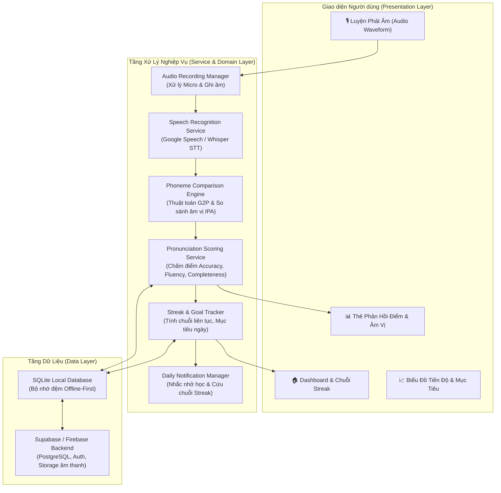

# 🎙️ BÀI TẬP THỰC HÀNH 3 (TH3): ỨNG DỤNG HỌC TIẾNG ANH THÔNG MINH - SPEAKUP AI
## HỆ THỐNG LUYỆN PHÁT ÂM TIẾNG ANH AI & THEO DÕI KỶ LUẬT HỌC TẬP HẰNG NGÀY

---

> 🏛️ **BỘ NÔNG NGHIỆP VÀ PHÁT TRIỂN NÔNG THÔN — TRƯỜNG ĐẠI HỌC THỦY LỢI**  
> 🏢 **KHOA CÔNG NGHỆ THÔNG TIN — BỘ MÔN CÔNG NGHỆ PHẦN MỀM**  
> 📚 **Học phần:** Phát triển Ứng dụng Di động (Mobile Application Development - CSE441)  
> 🏷️ **Bài tập:** Bài tập Thực hành 3 (TH3) — Phát triển Ứng dụng Học Tiếng Anh Thông Minh  
> 👥 **Đơn vị thực hiện:** **Nhóm 16 — Lớp 65KTPM**  
> 📅 **Thời gian hoàn thành:** Học kỳ 1 — Năm học 2026–2027  

---

## 👥 DANH SÁCH THÀNH VIÊN NHÓM 16 VÀ PHÂN CÔNG TRÁCH NHIỆM

| STT | Họ và Tên | Mã Sinh Viên | Vai Trò | Phân Hệ Nhiệm Vụ Phụ Trách (7 Mục Checklist TH3) | Nhánh Git | Trạng Thái |
|:---:|:---|:---:|:---:|:---|:---:|:---:|
| **1** | **Nguyễn Văn Huỳnh** | **2351170599** | **Nhóm trưởng** | **Mục 1:** Thiết kế CSDL (PostgreSQL & SQLite Local Cache), kiến trúc hệ thống Clean Architecture, Auth & User Management.<br>**Mục 7:** Kiểm thử tự động (Unit & Integration Test), điều phối Git Flow & Đóng gói sản phẩm (APK & Web). | `huynh-th3-architecture-database-testing` | 🚀 Đã lên kế hoạch & Triển khai |
| **2** | **Lê Anh Tuấn** | **2151060296** | **Thành viên** | **Mục 2:** Xây dựng tính năng theo dõi tiến độ: thuật toán đếm chuỗi ngày học liên tục (Streak Tracker), thời gian học, Daily Goal.<br>**Mục 6:** Hệ thống thông báo nhắc nhở luyện tập hàng ngày (Daily Notifications) & Giao diện Dashboard tiến độ. | `letuan-th3-streak-progress-notification` | 🚀 Đã lên kế hoạch & Triển khai |
| **3** | **NGUYỄN TRUNG KIÊN** | **2251172394** | **Thành viên** | **Mục 3:** Tích hợp Speech Recognition API thu âm & xử lý giọng nói người dùng; Bộ phát âm mẫu TTS.<br>**UI Tương tác:** Giao diện thu âm trực quan, hiệu ứng sóng âm thanh (Waveform Visualizer), Audio Player. | `kien-th3-speech-recognition-audioui` | 🚀 Đã lên kế hoạch & Triển khai |
| **4** | **Trần Anh Tuấn** | **2351170629** | **Thành viên** | **Mục 4:** Mô hình AI / Thuật toán so sánh âm vị (Phoneme Comparison: G2P, Phonetic Levenshtein, IPA matching), bộ chấm điểm.<br>**Mục 5:** Module phản hồi trực quan: Thẻ điểm, highlight âm vị đúng/sai/thiếu, đề xuất bài tập cá nhân hóa. | `trantuan-th3-ai-phoneme-scoring-feedback` | 🚀 Đã lên kế hoạch & Triển khai |

---

## 📋 ĐỐI SOÁT 7 MỤC CHECKLIST YÊU CẦU ĐỀ BÀI TH3

| STT | Mục Checklist Yêu Cầu | Mục Tiêu Kỹ Thuật & Giải Pháp Triển Khai | Thành Viên Phụ Trách | File Mã Nguồn / Bàn Giao |
|:---:|:---|:---|:---:|:---|
| **1** | **Thiết kế cơ sở dữ liệu** | • Thiết kế Schema lưu trữ Users, Lessons, Practice Words, Pronunciation Logs, Phoneme Results, Daily Streaks.<br>• Hỗ trợ SQLite Local Cache và đồng bộ đám mây Supabase PostgreSQL. | **Nguyễn Văn Huỳnh** | • `th3_database_schema.sql`<br>• `lib/data/database_helper.dart`<br>• `lib/models/user_model.dart` |
| **2** | **Theo dõi tiến độ học tập** | • Thuật toán tính Streak đếm số ngày liên tục, cơ chế Freeze Streak bảo vệ chuỗi.<br>• Đặt mục tiêu hàng ngày (Daily Goals: 5, 10, 15 phút hoặc số từ phát âm), thống kê tổng thời gian luyện tập. | **Lê Anh Tuấn** | • `lib/services/streak_service.dart`<br>• `lib/models/user_progress_model.dart`<br>• `lib/features/progress/` |
| **3** | **Tích hợp Speech Recognition API** | • Thu âm giọng nói người dùng qua Microphone (AAC/WAV).<br>• Tích hợp Speech Recognition (Google Cloud Speech-to-Text / Whisper AI) chuyển đổi âm thanh thành văn bản & timestamp âm vị.<br>• Audio Waveform Visualizer hiển thị sóng âm khi nói. | **NGUYỄN TRUNG KIÊN** | • `lib/services/speech_recognition_service.dart`<br>• `lib/services/audio_recording_manager.dart`<br>• `lib/widgets/waveform_visualizer.dart` |
| **4** | **Mô hình AI so sánh âm vị & chấm điểm** | • Chuyển đổi từ vựng chuẩn sang ký hiệu ngữ âm quốc tế IPA (Grapheme-to-Phoneme).<br>• Thuật toán căn gióng chuỗi âm vị (Phonetic Alignment / Levenshtein Distance).<br>• Chấm điểm 3 tiêu chí: Độ chính xác (Accuracy), Độ trôi chảy (Fluency), Độ đầy đủ (Completeness). | **Trần Anh Tuấn** | • `lib/services/phoneme_comparison_engine.dart`<br>• `lib/services/pronunciation_scoring_service.dart`<br>• `lib/models/pronunciation_result_model.dart` |
| **5** | **Xây dựng module phản hồi trực quan** | • Hiển thị điểm số dạng Gauge Chart trực quan (0 - 100 điểm).<br>• Highlight màu trực tiếp trên từ: Âm đúng (Xanh lục), Âm sai (Đỏ), Âm nuốt/thiếu (Vàng cam).<br>• Đề xuất danh sách bài tập cải thiện dựa trên các âm vị yếu (Targeted Exercises). | **Trần Anh Tuấn** | • `lib/widgets/phoneme_feedback_widget.dart`<br>• `lib/widgets/score_card_widget.dart`<br>• `lib/services/targeted_lesson_recommender.dart` |
| **6** | **Hệ thống thông báo nhắc nhở & UI tiến độ** | • Thiết lập thông báo cục bộ định kỳ (`flutter_local_notifications` / AlarmManager) theo giờ học viên cài đặt.<br>• Smart Reminder: Nhắc nhở gấp khi học viên sắp đứt chuỗi Streak.<br>• Giao diện màn hình Dashboard hiển thị biểu đồ học tập tuần/tháng, Streak Calendar. | **Lê Anh Tuấn** | • `lib/services/daily_notification_service.dart`<br>• `lib/views/progress_dashboard_view.dart`<br>• `lib/widgets/streak_badge_widget.dart` |
| **7** | **Kiểm thử đa người dùng & Đa giọng nói** | • Xây dựng bộ Test Case kiểm thử với nhiều chất giọng (Accent: Giọng Việt nói tiếng Anh, Giọng Anh - Mỹ chuẩn, Giọng trẻ em/người lớn).<br>• Đánh giá độ nhạy và tính chuẩn xác của mô hình AI chấm điểm phát âm.<br>• Kiểm thử Unit Test, Widget Test và đóng gói APK release. | **Nguyễn Văn Huỳnh** (Chủ trì)<br>& Cả nhóm phối hợp | • `test/phoneme_engine_test.dart`<br>• `test/streak_service_test.dart`<br>• `KICH_BAN_KIEM_THU_TH3.md` |

---

## 🏗️ KIẾN TRÚC HỆ THỐNG ỨNG DỤNG (SYSTEM ARCHITECTURE)



---

## 📁 CẤU TRÚC THƯ MỤC DỰ ÁN TH3

```
TH3/
├── README.md                              # Báo cáo tổng quan dự án TH3 & Đối soát 7 checklist
├── PHAN_CHIA_CONG_VIEC_TH3.md             # Kế hoạch chi tiết phân bổ công việc 4 thành viên
├── THIET_KE_KIEN_TRUC_CSDL_TH3.md         # Tài liệu thiết kế CSDL & Luồng AI xử lý âm thanh
├── KICH_BAN_KIEM_THU_TH3.md               # Kịch bản kiểm thử 7 checklist & Ma trận test giọng nói
├── th3_database_schema.sql                # Mã nguồn DDL tạo bảng CSDL quan hệ
├── lib/                                   # Mã nguồn cốt lõi ứng dụng
│   ├── core/                              # Hằng số, Theme, Tiện ích âm thanh
│   ├── models/                            # User, Lesson, PronunciationResult, Streak
│   │   ├── user_model.dart
│   │   ├── user_progress_model.dart
│   │   └── pronunciation_result_model.dart
│   ├── services/                          # Các dịch vụ logic chính
│   │   ├── audio_recording_manager.dart
│   │   ├── speech_recognition_service.dart
│   │   ├── phoneme_comparison_engine.dart
│   │   ├── pronunciation_scoring_service.dart
│   │   ├── streak_service.dart
│   │   └── daily_notification_service.dart
│   ├── views/                             # Giao diện màn hình
│   │   ├── pronunciation_practice_view.dart
│   │   ├── pronunciation_feedback_view.dart
│   │   └── progress_dashboard_view.dart
│   └── widgets/                           # Component UI tái sử dụng
│       ├── waveform_visualizer.dart
│       ├── phoneme_feedback_widget.dart
│       ├── streak_badge_widget.dart
│       └── score_card_widget.dart
└── test/                                  # Bộ kiểm thử tự động
    ├── phoneme_engine_test.dart           # Kiểm thử thuật toán AI chấm điểm âm vị
    └── streak_service_test.dart           # Kiểm thử logic chuỗi ngày & mục tiêu học
```

---

## 🚀 HƯỚNG DẪN BẮT ĐẦU DỰ ÁN

1. **Khởi tạo cơ sở dữ liệu:**
   Chạy tệp `th3_database_schema.sql` trên cơ sở dữ liệu PostgreSQL hoặc cấu hình vào SQLite cục bộ.
2. **Kiểm thử logic cốt lõi:**
   Chạy các bài kiểm thử tự động trong thư mục `test/`:
   ```bash
   dart test test/phoneme_engine_test.dart
   dart test test/streak_service_test.dart
   ```
3. **Xem chi tiết phân chia công việc:**
   Đọc tệp `PHAN_CHIA_CONG_VIEC_TH3.md` để nắm rõ các mốc Sprint và trách nhiệm từng thành viên.
