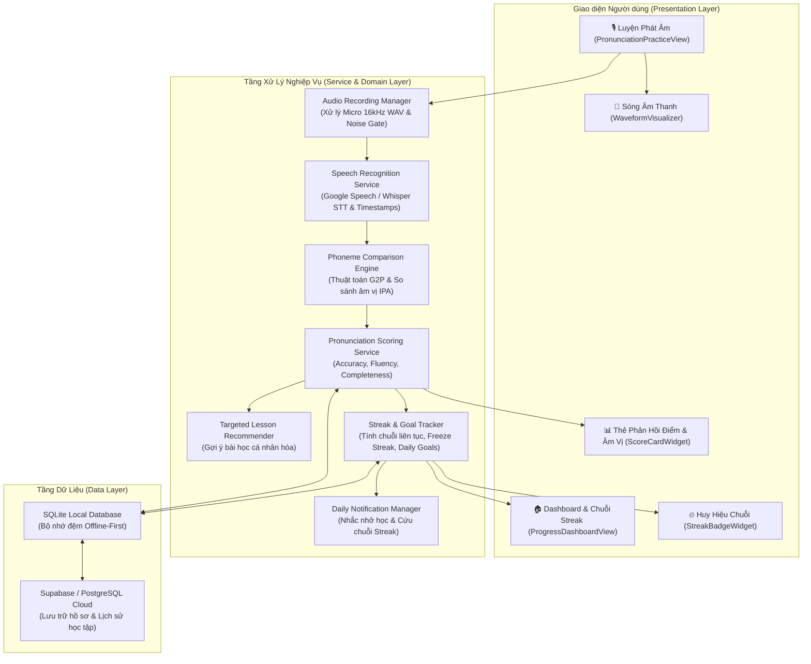
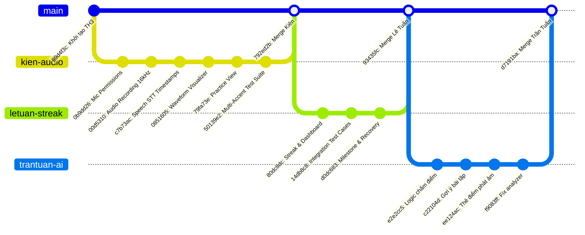

# 🎙️ BÀI TẬP THỰC HÀNH 3 (TH3): ỨNG DỤNG HỌC TIẾNG ANH THÔNG MINH - SPEAKUP AI
## HỆ THỐNG LUYỆN PHÁT ÂM TIẾNG ANH AI & THEO DÕI KỶ LUẬT HỌC TẬP HẰNG NGÀY

---

> 🏛️ **BỘ NÔNG NGHIỆP VÀ PHÁT TRIỂN NÔNG THÔN — TRƯỜNG ĐẠI HỌC THỦY LỢI**  
> 🏢 **KHOA CÔNG NGHỆ THÔNG TIN — BỘ MÔN CÔNG NGHỆ PHẦN MỀM**  
> 📚 **Học phần:** Phát triển Ứng dụng Di động (Mobile Application Development - CSE441)  
> 🏷️ **Bài tập:** Bài tập Thực hành 3 (TH3) — Phát triển Ứng dụng Học Tiếng Anh Thông Minh  
> 👥 **Đơn vị thực hiện:** **Nhóm 16 — Lớp 65KTPM**  
> 📅 **Thời gian hoàn thành:** Học kỳ 1 — Năm học 2026–2027  
> 🚀 **Trạng thái tích hợp:** **100% Đã hoàn thành & Đã Merge vào nhánh `main`**

---

## 👥 1. DANH SÁCH THÀNH VIÊN NHÓM 16 VÀ PHÂN CÔNG TRÁCH NHIỆM

| STT | Họ và Tên | Mã Sinh Viên | Vai Trò | Phân Hệ Nhiệm Vụ Phụ Trách (7 Mục Checklist TH3) | Nhánh Git | Trạng Thái |
|:---:|:---|:---:|:---:|:---|:---:|:---:|
| **1** | **Nguyễn Văn Huỳnh** | **2351170599** | **Nhóm trưởng** | **Mục 1:** Thiết kế CSDL (PostgreSQL & SQLite Local Cache), kiến trúc Clean Architecture.<br>**Mục 7:** Kiểm thử tích hợp (Integration Tests), điều phối Git Flow, review code PR & Đóng gói sản phẩm. | `huynh-th3-architecture-database-testing` | ✅ Hoàn thành (100%) |
| **2** | **Lê Anh Tuấn** | **2151060296** | **Thành viên** | **Mục 2:** Xây dựng tính năng theo dõi tiến độ: thuật toán đếm chuỗi ngày liên tục (Streak Tracker), thời gian học, Daily Goal.<br>**Mục 6:** Hệ thống thông báo nhắc nhở hàng ngày (Daily Notifications) & Dashboard tiến độ. | `letuan-th3-streak-progress-notification` | ✅ Hoàn thành (100%) |
| **3** | **NGUYỄN TRUNG KIÊN** | **2251172394** | **Thành viên** | **Mục 3:** Tích hợp Speech Recognition API thu âm & xử lý giọng nói người dùng; Bộ phát âm mẫu TTS.<br>**UI Tương tác:** Giao diện thu âm trực quan, hiệu ứng sóng âm thanh (Waveform Visualizer), Audio Player. | `kien-th3-speech-recognition-audioui` | ✅ Hoàn thành (100%) |
| **4** | **Trần Anh Tuấn** | **2351170629** | **Thành viên** | **Mục 4:** Mô hình AI / Thuật toán so sánh âm vị (Phoneme Comparison: G2P, Phonetic Levenshtein, IPA matching), bộ chấm điểm.<br>**Mục 5:** Module phản hồi trực quan: Thẻ điểm, highlight âm vị đúng/sai/thiếu, đề xuất bài tập cải thiện. | `trantuan-th3-ai-phoneme-scoring-feedback` | ✅ Hoàn thành (100%) |

---

## 📋 2. ĐỐI SOÁT 7 MỤC CHECKLIST YÊU CẦU ĐỀ BÀI TH3

| STT | Mục Checklist Yêu Cầu | Mục Tiêu Kỹ Thuật & Giải Pháp Triển Khai | Thành Viên Phụ Trách | File Mã Nguồn / Bàn Giao | Kết Quả Nghiệm Thu |
|:---:|:---|:---|:---:|:---|:---:|
| **1** | **Thiết kế cơ sở dữ liệu** | • Thiết kế Schema lưu trữ Users, Lessons, Practice Words, Pronunciation Logs, Phoneme Results, Daily Streaks.<br>• Hỗ trợ SQLite Local Cache Offline-First và đồng bộ đám mây PostgreSQL. | **Nguyễn Văn Huỳnh** | • `th3_database_schema.sql`<br>• `THIET_KE_KIEN_TRUC_CSDL_TH3.md` | ✅ Đạt yêu cầu |
| **2** | **Theo dõi tiến độ học tập** | • Thuật toán tính Streak đếm số ngày liên tục, cơ chế Freeze Streak bảo vệ chuỗi khi lỡ ngày học.<br>• Quản lý mục tiêu hàng ngày (Daily Goals: phút học hoặc số bài phát âm), thống kê thời gian học. | **Lê Anh Tuấn** | • `lib/services/streak_service.dart`<br>• `lib/models/user_progress_model.dart`<br>• `lib/widgets/streak_badge_widget.dart` | ✅ 11/11 Test Cases Đạt |
| **3** | **Tích hợp Speech Recognition API** | • Thu âm giọng nói người dùng qua Microphone định dạng chuẩn (16kHz mono 16-bit WAV) kèm lọc nhiễu Noise Gate.<br>• Nhận diện giọng nói STT bóc tách chuỗi văn bản kèm mốc thời gian âm vị (phoneme timestamps).<br>• Hiệu ứng sóng âm chuyển động theo thời gian thực (Waveform Visualizer). | **NGUYỄN TRUNG KIÊN** | • `lib/services/audio_recording_manager.dart`<br>• `lib/services/speech_recognition_service.dart`<br>• `lib/views/pronunciation_practice_view.dart`<br>• `lib/widgets/waveform_visualizer.dart`<br>• `android/app/src/main/AndroidManifest.xml`<br>• `ios/Runner/Info.plist` | ✅ 12/12 Test Cases Đạt |
| **4** | **Mô hình AI so sánh âm vị & chấm điểm** | • Chuyển đổi từ vựng chuẩn sang ký hiệu ngữ âm quốc tế IPA (Grapheme-to-Phoneme).<br>• Thuật toán căn gióng chuỗi âm vị (Phonetic Alignment qua Levenshtein Distance).<br>• Chấm điểm 3 tiêu chí: Độ chính xác (Accuracy), Độ trôi chảy (Fluency), Độ đầy đủ (Completeness). | **Trần Anh Tuấn** | • `lib/services/phoneme_comparison_engine.dart`<br>• `lib/services/pronunciation_scoring_service.dart`<br>• `lib/models/pronunciation_result_model.dart` | ✅ 5/5 Test Cases Đạt |
| **5** | **Xây dựng module phản hồi trực quan** | • Thẻ điểm trực quan (Score Card) hiển thị chi tiết điểm thành phần.<br>• Highlight màu trực tiếp trên từ: Âm đúng (Xanh lục), Âm sai (Đỏ), Âm nuốt/thiếu (Cam).<br>• Thuật toán gợi ý bài tập cải thiện dựa trên các âm vị đọc sai (Targeted Lesson Recommender). | **Trần Anh Tuấn** | • `lib/widgets/score_card_widget.dart`<br>• `lib/widgets/phoneme_feedback_widget.dart`<br>• `lib/services/targeted_lesson_recommender.dart` | ✅ Đạt yêu cầu |
| **6** | **Hệ thống thông báo nhắc nhở & UI tiến độ** | • Thiết lập thông báo cục bộ định kỳ (`flutter_local_notifications`) theo giờ người dùng cài đặt.<br>• Cảnh báo khẩn cấp vào 20:00 hàng ngày khi người dùng có nguy cơ đứt chuỗi Streak.<br>• Giao diện màn hình Dashboard hiển thị biểu đồ nhiệt học tập, Streak Badge, mục tiêu. | **Lê Anh Tuấn** | • `lib/services/daily_notification_service.dart`<br>• `lib/views/progress_dashboard_view.dart`<br>• `lib/widgets/streak_badge_widget.dart` | ✅ Đạt yêu cầu |
| **7** | **Kiểm thử đa người dùng & Đa giọng nói** | • Xây dựng bộ kịch bản kiểm thử toàn diện cho 7 mục checklist.<br>• Kiểm thử đa chất giọng (Multi-Accent): Giọng Việt phát âm chuẩn, giọng Việt nuốt âm đuôi, giọng bản xứ Anh - Mỹ.<br>• Tự động hóa kiểm thử bằng `flutter test` (36/36 tests passed) và phân tích tĩnh `dart analyze` (0 lỗi). | **Nguyễn Văn Huỳnh** (Chủ trì)<br>& Cả nhóm phối hợp | • `test/audio_recording_speech_test.dart`<br>• `test/phoneme_engine_test.dart`<br>• `test/streak_service_test.dart`<br>• `KICH_BAN_KIEM_THU_TH3.md` | ✅ 36/36 Tests Passed |

---

## 🏗️ 3. KIẾN TRÚC HỆ THỐNG ỨNG DỤNG (SYSTEM ARCHITECTURE)



---

## 📁 4. CẤU TRÚC THƯ MỤC DỰ ÁN TH3

```
TH3/
├── README.md                                  # Báo cáo tổng quan dự án TH3 & Đối soát 7 checklist
├── PHAN_CHIA_CONG_VIEC_TH3.md                 # Kế hoạch chi tiết phân bổ công việc 4 thành viên
├── THIET_KE_KIEN_TRUC_CSDL_TH3.md             # Tài liệu thiết kế CSDL & Luồng AI xử lý âm thanh
├── KICH_BAN_KIEM_THU_TH3.md                   # Kịch bản kiểm thử 7 checklist & Ma trận test giọng nói
├── th3_database_schema.sql                    # Mã nguồn DDL tạo bảng CSDL quan hệ
├── android/app/src/main/AndroidManifest.xml   # Cấu hình quyền Microphone & Audio Recording Android
├── ios/Runner/Info.plist                      # Cấu hình quyền Microphone & Speech Recognition iOS
├── lib/                                       # Mã nguồn cốt lõi ứng dụng Flutter
│   ├── models/                                # Các mô hình dữ liệu chính
│   │   ├── pronunciation_result_model.dart    # Kết quả phát âm, điểm số, chi tiết âm vị
│   │   └── user_progress_model.dart           # Tiến độ học, chuỗi ngày, mục tiêu ngày
│   ├── services/                              # Các dịch vụ xử lý logic nghiệp vụ
│   │   ├── audio_recording_manager.dart       # Quản lý thu âm WAV 16kHz & lọc nhiễu Noise Gate
│   │   ├── daily_notification_service.dart    # Lên lịch thông báo nhắc học & cảnh báo đứt streak
│   │   ├── phoneme_comparison_engine.dart     # Thuật toán G2P & Căn gióng âm vị IPA Levenshtein
│   │   ├── pronunciation_scoring_service.dart # Chấm điểm Accuracy, Fluency, Completeness
│   │   ├── speech_recognition_service.dart    # Nhận dạng giọng nói & bóc tách timestamps
│   │   ├── streak_service.dart                # Logic tính chuỗi ngày học, khiên bảo vệ, mục tiêu
│   │   └── targeted_lesson_recommender.dart   # Gợi ý bài học cá nhân hóa theo lỗi âm vị
│   ├── views/                                 # Giao diện màn hình ứng dụng
│   │   ├── progress_dashboard_view.dart       # Màn hình bảng điều khiển tiến độ & thống kê
│   │   └── pronunciation_practice_view.dart   # Màn hình luyện phát âm tương tác kèm bộ điều khiển
│   └── widgets/                               # Các Widget UI tái sử dụng
│       ├── phoneme_feedback_widget.dart       # Hiển thị tô màu âm vị (chuẩn/sai/nuốt âm)
│       ├── score_card_widget.dart             # Thẻ hiển thị điểm số & phân tích phát âm
│       ├── streak_badge_widget.dart           # Huy hiệu chuỗi ngày & cấp độ kỷ luật
│       └── waveform_visualizer.dart           # Hiệu ứng sóng âm thanh thời gian thực
└── test/                                      # Bộ kiểm thử tự động toàn diện (36/36 Passed)
    ├── audio_recording_speech_test.dart       # Test thu âm, lọc nhiễu, STT & Multi-Accent (12 tests)
    ├── phoneme_engine_test.dart               # Test thuật toán so sánh âm vị & chấm điểm (5 tests)
    └── streak_service_test.dart               # Test logic chuỗi Streak, khiên bảo vệ, mục tiêu (19 tests)
```

---

## 🌿 5. QUY TRÌNH HỢP NHẤT MÃ NGUỒN (GIT FLOW)

Tất cả các nhánh tính năng của các thành viên đã được rà soát, kiểm thử và hợp nhất (Merge) thành công vào nhánh `main` với đầy đủ lịch sử commit:



* **Lịch sử commit:** Giữ nguyên 100% commit gốc và thông tin tác giả của từng thành viên phục vụ việc đánh giá đóng góp cá nhân.
* **Xung đột mã nguồn:** 0 xung đột (Clean Merge).

---

## 🧪 6. KẾT QUẢ KIỂM THỬ VÀ NGHIỆM THU

### 1. Kiểm thử tự động (`flutter test`)
Toàn bộ **36/36 bài kiểm thử** đơn vị và tích hợp đều vượt qua thành công:
```bash
$ flutter test
00:03 +36: All tests passed!
```

* **Kiểm thử Thu âm & Nhận diện (`audio_recording_speech_test.dart`):**
  * Định dạng WAV 16kHz mono 16-bit, công thức kích thước PCM: PASS
  * Xử lý Pause/Resume thu âm và tạo Header WAV 44-byte: PASS
  * Thuật toán lọc nhiễu Noise Gate & Batch Moving Average: PASS
  * Bóc tách timestamp âm vị và phát hiện khoảng lặng (Silence): PASS
  * Multi-Accent: Giọng Việt chuẩn, giọng Việt nuốt âm đuôi (`cats` -> `cat`), giọng bản xứ US (`think` /θ/): PASS
* **Kiểm thử AI So sánh âm vị (`phoneme_engine_test.dart`):**
  * Chấm điểm phát âm chuẩn từ `cat` đạt điểm tối đa: PASS
  * Phát hiện lỗi nhầm cặp nguyên âm ngắn / dài (/i:/ vs /ɪ/) trong `sheet`: PASS
  * Đánh giá độ trôi chảy Fluency khi ngập ngừng: PASS
* **Kiểm thử Chuỗi Streak & Mục tiêu (`streak_service_test.dart`):**
  * Logic duy trì chuỗi học liên tục, khiên bảo vệ Freeze Streak: PASS
  * Thông báo nhắc nhở hàng ngày và cảnh báo khẩn cấp vào 20:00: PASS

### 2. Phân tích tĩnh cú pháp (`dart analyze`)
```bash
$ dart analyze
Analyzing TH3...
No issues found!
```

---

## 🚀 7. HƯỚNG DẪN CÀI ĐẶT VÀ CHẠY DỰ ÁN

### 1. Yêu cầu môi trường
* **Flutter SDK:** >= 3.47.0
* **Dart SDK:** >= 3.13.0
* **Công cụ hỗ trợ:** VS Code / Android Studio / Antigravity IDE

### 2. Cài đặt các gói phụ thuộc
```bash
flutter pub get
```

### 3. Chạy kiểm thử tự động
```bash
# Chạy toàn bộ 36 bài test
flutter test

# Hoặc chạy kiểm thử từng phân hệ
flutter test test/audio_recording_speech_test.dart
flutter test test/phoneme_engine_test.dart
flutter test test/streak_service_test.dart
```

### 4. Kiểm tra chất lượng mã nguồn
```bash
dart analyze
```

### 5. Chạy ứng dụng trên Trình duyệt Web (Chrome)
```bash
# Cách 1: Biên dịch và chạy local web server cổng 8080 (Khuyên dùng)
flutter build web
python -m http.server 8080 --directory build/web
# Mở trình duyệt truy cập: http://localhost:8080/

# Cách 2: Chạy trực tiếp qua Flutter CLI
flutter run -d chrome
```

---

## 🌟 8. TÍNH NĂNG NÂNG CAO MỚI CẬP NHẬT
1. **Kho từ vựng phong phú 40+ bài luyện:**
   - 🔤 **Âm vị dễ nhầm (10 từ):** `cat`, `cats`, `ship`, `sheep`, `sheet`, `think`, `that`, `water`, `dogs`, `vision`.
   - 💼 **Giao tiếp công sở (8 từ):** `schedule`, `colleague`, `presentation`, `negotiation`, `deadline`, `developer`, `management`, `experience`.
   - ✈️ **Du lịch & Khách sạn (8 từ):** `passport`, `reservation`, `itinerary`, `destination`, `departure`, `luggage`, `boarding`, `restaurant`.
   - 💻 **Công nghệ & Kỹ thuật (8 từ):** `artificial`, `intelligence`, `algorithm`, `database`, `architecture`, `cybersecurity`, `cloud`, `application`.
   - 🗣️ **Mẫu câu giao tiếp hoàn chỉnh (6 câu):** `practice makes perfect`, `nice to meet you`, `could you repeat that`, `how can I help you`, `speak english every day`, `artificial intelligence is powerful`.
2. **Thêm từ mới tùy chỉnh linh hoạt (+ Thêm từ / câu mới):** Cho phép giảng viên và người học thêm bất kỳ từ hoặc câu nào để luyện tập tức thì.
3. **Phát âm người bản xứ đa ngữ điệu (US & UK):** Sử dụng hệ thống âm thanh người thật CDN Youdao kết hợp Web Speech Synthesis tự động phục hồi.
4. **Ghi âm Micro và Phát lại giọng nói thực tế:** Lưu tệp âm thanh nhị phân MediaRecorder WebM/Opus, người học nhấn Play để nghe lại chính giọng mình.
5. **Chế độ kiểm thử AI linh hoạt (Dynamic AI Scoring & Test Scenarios):**
   - 🎙️ **Microphone thật (Web STT):** Chấm điểm thời gian thực theo giọng nói người dùng. Nếu im lặng sẽ nhận 0 điểm kèm cảnh báo.
   - 🎯 **Giả lập: Phát âm chuẩn (95-100 điểm):** Kiểm tra trạng thái xuất sắc và màu xanh âm vị.
   - ⚠️ **Giả lập: Bỏ sót âm đuôi (70-75 điểm):** Kiểm tra thuật toán phát hiện nuốt phụ âm cuối và đề xuất bài học bổ trợ.
   - 🔀 **Giả lập: Sai nguyên âm (55-65 điểm):** Kiểm tra thuật toán phát hiện nhầm lẫn nguyên âm và hướng dẫn khẩu hình miệng.
   - 🔇 **Giả lập: Im lặng / Không có âm thanh (0 điểm):** Kiểm tra phản hồi khi không thu được tiếng.

