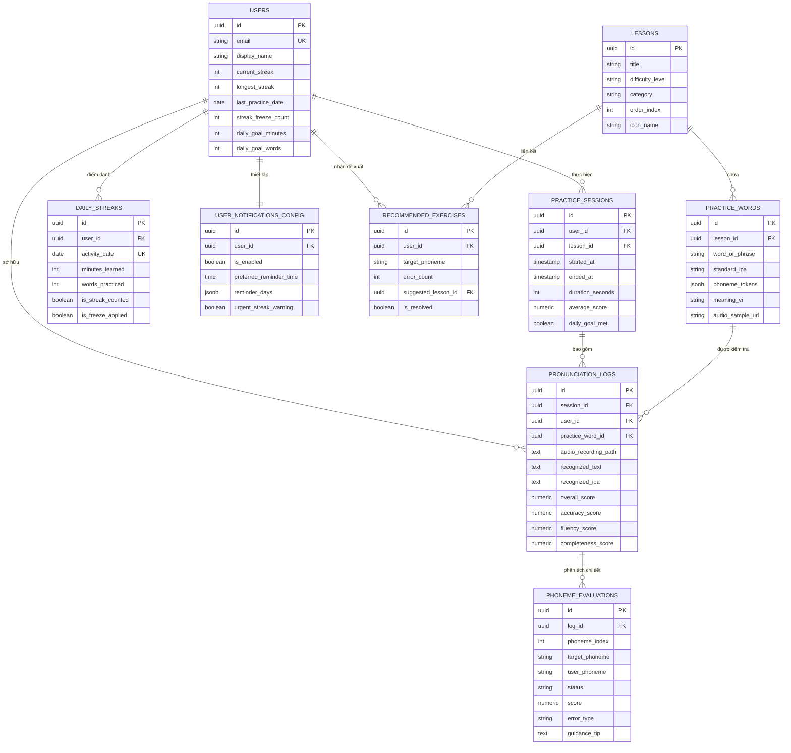
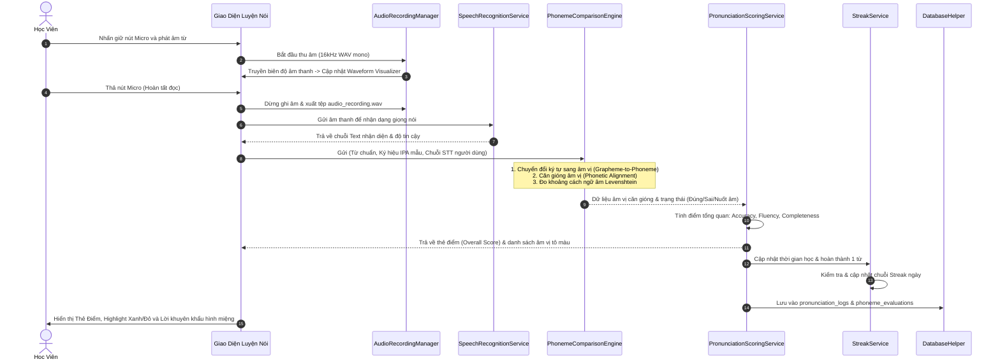

# 📐 TÀI LIỆU THIẾT KẾ KIẾN TRÚC HỆ THỐNG & CƠ SỞ DỮ LIỆU (TH3)
## DỰ ÁN: ỨNG DỤNG HỌC TIẾNG ANH AI & RÈN LUYỆN KỶ LUẬT (SPEAKUP AI)

---

> **Môn học:** Phát triển Ứng dụng Di động (CSE441)  
> **Nhóm thực hiện:** Nhóm 16 — Lớp 65KTPM — Trường Đại học Thủy Lợi  
> **Tác giả chủ trì thiết kế:** Nguyễn Văn Huỳnh (Nhóm trưởng)  

---

## 1. KIẾN TRÚC HỆ THỐNG CLEAN ARCHITECTURE

Hệ thống được thiết kế theo nguyên lý **Clean Architecture** phân tách 3 lớp rõ ràng nhằm đảm bảo tính module hóa, dễ dàng kiểm thử tự động (Unit Test) và mở rộng tính năng:

```mermaid
flowchart TD
    subgraph PresentationLayer["1. Presentation Layer (Tầng Giao Diện)"]
        UI_Home["DashboardView\n(Streak Counter, Quick Practice, Daily Goal)"]
        UI_Practice["PronunciationPracticeView\n(Waveform Visualizer, Mic Control, Native Audio)"]
        UI_Feedback["PronunciationFeedbackView\n(Gauge Score, Phoneme Highlights, Tip Accordion)"]
        UI_Progress["ProgressAnalyticsView\n(Weekly Chart, Calendar Heatmap, Mistake History)"]
    end

    subgraph DomainLayer["2. Domain & Application Layer (Tầng Nghiệp Vụ)"]
        RecManager["AudioRecordingManager\n(Thu âm 16kHz mono, Lọc nhiễu)"]
        SpeechService["SpeechRecognitionService\n(Nhận diện Speech-to-Text & Text Timestamps)"]
        PhonemeEngine["PhonemeComparisonEngine\n(G2P, Căn gióng âm vị Levenshtein / DTW)"]
        ScoreCalculator["PronunciationScoringService\n(Tính điểm Accuracy, Fluency, Completeness)"]
        StreakService["StreakTrackerService\n(Đếm ngày học, Quản lý Freeze Streak, Daily Goal)"]
        NotifyService["DailyNotificationService\n(Local Notifications, Smart Warning Reminder)"]
        Recommender["TargetedLessonRecommender\n(Gợi ý bài tập cải thiện dựa trên âm sai)"]
    end

    subgraph DataLayer["3. Data & Infrastructure Layer (Tầng Dữ Liệu)"]
        LocalSQLite["SQLite Database (sqflite)\n(Lưu trữ đệm Local-First khi mất mạng)"]
        SupabaseCloud["Supabase PostgreSQL Cloud\n(Đồng bộ đám mây, Bảng lịch sử, Row Level Security)"]
        AudioStorage["Supabase Storage / Local File Storage\n(Lưu trữ file âm thanh người dùng & bài mẫu)"]
    end

    PresentationLayer --> DomainLayer
    DomainLayer --> DataLayer
```

---

## 2. SƠ ĐỒ THỰC THỂ LIÊN KẾT CƠ SỞ DỮ LIỆU (ERD)

Hệ thống CSDL bao gồm 9 bảng quan hệ chặt chẽ, tối ưu hóa để vừa lưu trữ tiến độ thói quen vừa lưu chi tiết kết quả phân tích âm vị của AI:

---

## 3. LUỒNG XỬ LÝ NHẬN DẠNG GIỌNG NÓI & CHẤM ĐIỂM ÂM VỊ BẰNG AI

---

## 4. CÔNG THỨC & THUẬT TOÁN CỐT LÕI

### 4.1. Thuật toán so sánh âm vị (Phoneme Comparison)
1. **Căn gióng âm vị (Phonetic Sequence Alignment):**  
   Sử dụng biến thể của thuật toán **Needleman-Wunsch Alignment** với ma trận tương đồng âm thanh (Consonant/Vowel acoustic similarity matrix):
   $$\text{Score}(P_{target}, P_{user}) = \begin{cases} 1.0 & \text{nếu trùng khớp hoàn toàn } (P_{target} = P_{user}) \\ 0.5 & \text{nếu cùng nhóm khẩu hình (VD: /p/ và /b/, /t/ và /d/) } \\ 0.0 & \text{nếu sai khác hoàn toàn hoặc nuốt âm} \end{cases}$$

2. **Công thức tính điểm tổng quan (Overall Score):**
   $$\text{Overall Score} = 0.6 \times \text{Accuracy} + 0.25 \times \text{Fluency} + 0.15 \times \text{Completeness}$$
   * **Accuracy (Độ chính xác âm vị):** Tỷ lệ phần trăm âm vị đọc đúng trên tổng số âm vị của từ chuẩn.
   * **Fluency (Độ trôi chảy):** Đánh giá dựa trên độ trễ ngập ngừng (pause duration) và tốc độ phát âm chuẩn (syllables per second).
   * **Completeness (Độ hoàn thiện):** Tỷ lệ các âm tiết người dùng không bỏ sót (đặc biệt phạt nặng lỗi thiếu âm đuôi /s/, /t/, /d/).

### 4.2. Thuật toán đếm chuỗi Streak & Bảo vệ chuỗi (Streak Logic)
* Gọi $D_{last}$ là ngày luyện tập gần nhất, $D_{now}$ là ngày hôm nay.
* Khoảng cách ngày $\Delta = D_{now} - D_{last}$:
  * Nếu $\Delta = 0$: Học viên tiếp tục học trong ngày -> Cộng dồn số phút học `minutes_learned`, giữ nguyên `current_streak`.
  * Nếu $\Delta = 1$: Ngày tiếp theo liên tục -> Tăng `current_streak = current_streak + 1`. Nếu `current_streak > longest_streak` thì cập nhật kỷ lục mới.
  * Nếu $\Delta = 2$: Bỏ lỡ 1 ngày:
    * Nếu `streak_freeze_count > 0`: Kích hoạt **Đóng băng chuỗi (Streak Freeze)** -> Giữ nguyên chuỗi, trừ `streak_freeze_count = streak_freeze_count - 1`, gửi thông báo cứu chuỗi thành công.
    * Nếu `streak_freeze_count == 0`: Đứt chuỗi -> Reset `current_streak = 1`.
  * Nếu $\Delta > 2$: Bỏ lỡ quá nhiều ngày -> Reset `current_streak = 1`.
